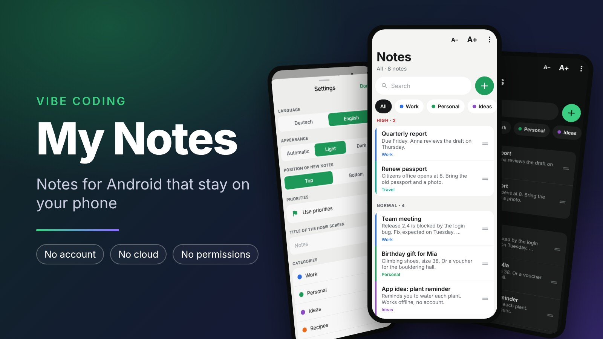
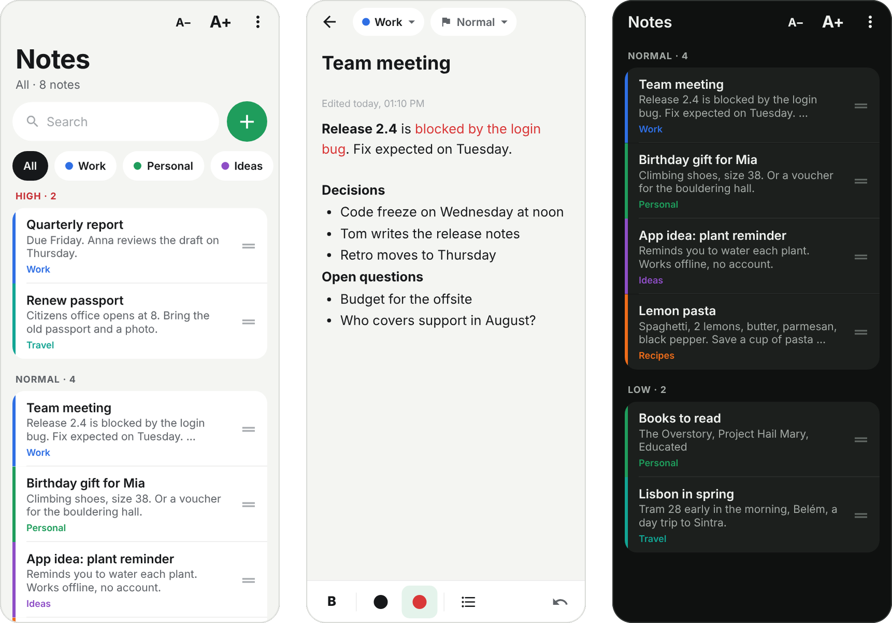
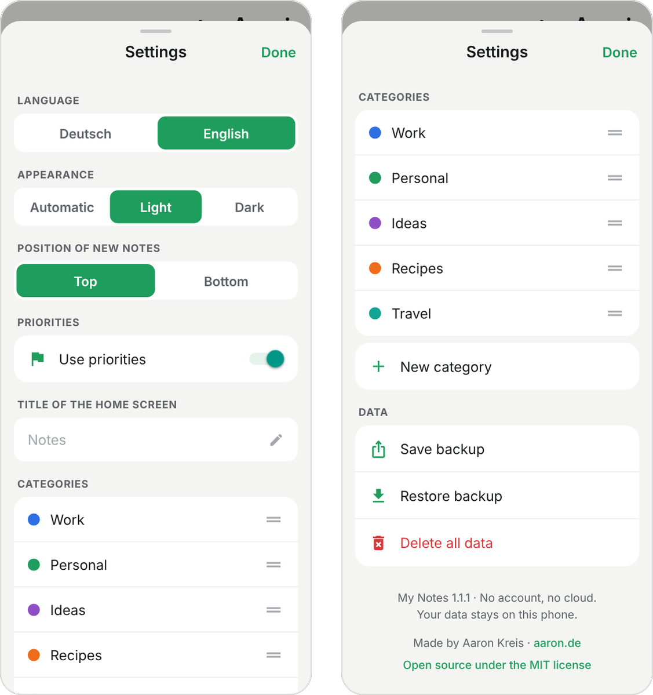

# My Notes

<p align="center">
  
</p>

<p align="center">
  <b>Notes for Android that stay on your phone.</b><br>
  No account · No cloud · No permissions · English and German
</p>

<p align="center">
  <a href="#english">English</a> ·
  <a href="#deutsch">Deutsch</a> ·
  <a href="LICENSE">MIT License</a>
</p>

<p align="center">
  
</p>

<p align="center">
  
</p>

## English

### About the app

My Notes is a note taking app for Android. Writing comes first, not ticking things off: there are no checklists. Notes live in categories with their own color and can be ordered by priority and by hand. All data stays in a database on your phone.

### Features

- **Home screen:** Notes are shown in three sections: High, Normal and Low. The chips at the top filter by category, "All" shows everything. Under "All", notes within a section follow the order of the categories, and each note shows the name of its category.
- **Order:** Drag a note by the handle on the right. Dragging it into another section changes its priority. Under "All", a note stays within its category while dragging.
- **Writing:** The plus button opens a new note with title and text. The text supports bold, red, black and bullet lists, visible while you type. Saving is automatic. If title and text stay empty, nothing is saved.
- **Dictation:** Use the microphone of your keyboard (Gboard, Samsung Keyboard) to speak into any field, including the note text. The keyboard does the recognition, My Notes needs no permission for it. With Gboard's offline voice typing, the audio stays on the phone.
- **Organize:** A long press on a note, or a tap on category or priority in the editor, opens a sheet with category, priority (Low, Normal, High) and "Delete note". This also works for a new note before it is saved.
- **Delete:** "Delete note" or swipe left. "Undo" then appears for a few seconds.
- **Categories:** Create, rename, recolor (12 colors) and sort them by the handle in the settings. Before deleting a category, the app asks and tells how many notes will be deleted with it. This can be undone too. If no category is left, the app creates "General" again.
- **Search:** Searches title and text, ignoring case and accents ("muller" and "mueller" find "Müller"). Matches are highlighted in yellow and can be narrowed down by category.
- **Text size:** A− and A+ at the top of the home screen change the text size of the whole app in five steps from 85 % to 150 %, on top of the Android setting.
- **Priorities off:** A switch in the settings hides priorities everywhere. The home screen then shows one list without sections and with its own order, and new notes get Normal. Stored priorities and the order within the sections are kept and come back when you switch priorities on again.
- **Settings:** language, appearance (Automatic, Light, Dark), position of new notes (top or bottom, default top), priorities on or off, custom title of the home screen (default "Notizen" or "Notes"), categories, save and restore a backup file, delete all data.
- **English and German:** Without a choice of your own, the app follows the language of the phone. When you tap an input field, the keyboard gets a hint for the chosen language. Gboard and Samsung Keyboard then switch layout and suggestions, provided the language is set up in the keyboard.

### Privacy

- The app requests no permissions. Without the internet permission, Android blocks every network access of the app.
- The editor runs in an embedded web view that only shows a page built into the app. It loads nothing, opens no addresses and runs nothing from pasted text. Pasted text comes in without foreign formatting.
- For the editor's web view, usage statistics to Google (`MetricsOptOut`) and address checks via Google Safe Browsing are turned off (`plugins/withPrivacy.js`).
- The links to aaron.de and GitHub open the phone's browser. The app itself loads nothing.
- No ads, no tracking, no analytics.
- Android's automatic backup to Google's cloud is turned off (`allowBackup: false`). Notes only leave the phone when you share a backup yourself.

### Install the APK

1. Copy the file to your phone (USB cable, or send it to yourself by email or messenger).
2. Tap it in the Files app.
3. Android asks whether to allow installs from this source. Allow it once.
4. Install. The app appears as "My Notes" with a green icon.

The APK runs on phones with a 64 bit processor (arm64).

### Build your own APK

```
bash scripts/build-apk.sh
```

The script runs on Linux or WSL. It sets up the Android SDK if needed, runs type checks and tests, generates the Android project, adds the signing configuration and writes the APK to `apk/`. The signing key lives in `signing/` (listed in `.gitignore`) together with a file `signing/keystore.properties`:

```
storeFile=mynotes.keystore
keyAlias=mynotes
storePassword=...
keyPassword=...
```

Keep the key safe: Android only installs an update if it is signed with the same key. Before releasing an update, increase `version` and `versionCode` in `app.json`.

### Development

```
npm install
npx expo start
```

Everything runs in Expo Go except the language hint for the keyboard. That needs the module in `modules/keyboard-language` and therefore a built APK.

| Command | Purpose |
|---|---|
| `npm test` | automated tests of logic, search and storage |
| `npm run typecheck` | type check |
| `node scripts/icons.cjs` | regenerate the app icons (needs Playwright) |

Always add new packages with `npx expo install <package>`.

### Project structure

```
App.tsx                    start: open the database, load settings, show the UI
src/domain/                data model, timestamps, merging, text and search
src/data/                  storage: SQLite on the phone, in memory for tests
src/store/                 NotesStore: the only way to change data
src/ui/                    screens, all texts in English and German in i18n.ts
src/ui/editorHtml.ts       the text editor in the web view
modules/keyboard-language  Android module for the keyboard language hint
plugins/withPrivacy.js     privacy settings for the web view
scripts/                   build the APK, generate icons
```

The text is stored as a small HTML with a fixed vocabulary: `<div>`, `<br>`, `<b>`, `<span class="r">` for red, `<ul>` and `<li>`. For red only "red" is stored, not the color value, so dark mode can show a lighter shade. Every field carries its own timestamp and deletions are only marked, as in Shopping List. A future sync can build on this.

### License

My Notes is open source under the MIT license, see [LICENSE](LICENSE).

## Deutsch

### Über die App

My Notes ist eine Notiz App für Android. Im Vordergrund steht das Schreiben, nicht das Abhaken: Es gibt keine Checklisten. Notizen stehen in Kategorien mit eigener Farbe und lassen sich nach Priorität und eigener Reihenfolge ordnen. Alle Daten bleiben in einer Datenbank auf dem Handy.

### Funktionen

- **Startseite:** Die Notizen stehen in drei Abschnitten: Hoch, Normal und Niedrig. Die Chips oben filtern nach Kategorie, „Alle“ zeigt alles. Unter „Alle“ stehen die Notizen innerhalb eines Abschnitts in der Reihenfolge der Kategorien, unter jeder Notiz steht der Name ihrer Kategorie.
- **Reihenfolge:** Am Griff rechts lässt sich eine Notiz verschieben. Zieht man sie in einen anderen Abschnitt, ändert sich ihre Priorität. Unter „Alle“ bleibt eine Notiz beim Ziehen in ihrer Kategorie.
- **Schreiben:** Das Plus öffnet eine neue Notiz mit Titel und Text. Der Text kennt Fett, Rot, Schwarz und Aufzählungen, sichtbar schon beim Schreiben. Gespeichert wird automatisch. Bleiben Titel und Text leer, wird nichts gespeichert.
- **Diktieren:** Über das Mikrofon der Tastatur (Gboard, Samsung Keyboard) lässt sich in jedes Feld sprechen, auch in den Notiztext. Die Erkennung macht die Tastatur, My Notes braucht dafür keine Berechtigung. Mit der Offline Spracheingabe von Gboard bleibt der Ton auf dem Handy.
- **Einordnen:** Langes Drücken auf eine Notiz, oder im Editor ein Tipp auf Kategorie oder Priorität, öffnet ein Fenster mit Kategorie, Priorität (Niedrig, Normal, Hoch) und „Notiz löschen“. Das geht auch bei einer neuen Notiz, bevor sie gespeichert ist.
- **Löschen:** „Notiz löschen“ oder nach links wischen. Danach erscheint für einige Sekunden „Rückgängig“.
- **Kategorien:** In den Einstellungen anlegen, umbenennen, umfärben (12 Farben) und per Griff sortieren. Beim Löschen einer Kategorie fragt die App nach und nennt die Zahl der Notizen, die mitgelöscht werden. Auch das lässt sich danach rückgängig machen. Ist keine Kategorie mehr übrig, legt die App „Allgemein“ wieder an.
- **Suche:** Sucht in Titel und Text, ohne Groß und Kleinschreibung und ohne Umlaut Probleme („muller“ und „mueller“ finden „Müller“). Treffer sind gelb markiert und lassen sich nach Kategorie eingrenzen.
- **Schriftgröße:** A− und A+ oben auf der Startseite ändern die Schrift der ganzen App in fünf Stufen von 85 % bis 150 %, zusätzlich zur Einstellung von Android.
- **Prioritäten ausschalten:** Ein Schalter in den Einstellungen blendet die Prioritäten überall aus. Die Startseite zeigt dann eine Liste ohne Abschnitte mit eigener Reihenfolge, neue Notizen bekommen Normal. Die gespeicherten Prioritäten und die Reihenfolge in den Abschnitten bleiben erhalten und sind nach dem Einschalten wieder da.
- **Einstellungen:** Sprache, Darstellung (Automatisch, Hell, Dunkel), „Anordnung neuer Einträge“ (Oben oder Unten, Standard Oben), Prioritäten an oder aus, eigener Titel der Startseite (Standard „Notizen“ oder „Notes“), Kategorien, Sicherung als Datei speichern und laden, alle Daten löschen.
- **Deutsch und Englisch:** Ohne eigene Wahl richtet sich die Sprache nach dem Handy. Beim Antippen eines Eingabefelds bekommt die Tastatur den Hinweis auf die gewählte Sprache. Gboard und Samsung Keyboard stellen dann Layout und Wortvorschläge um, sofern die Sprache in der Tastatur eingerichtet ist.

### Datenschutz

- Die App fragt nach keiner Berechtigung. Ohne Internet Berechtigung verhindert Android jeden Netzzugriff der App.
- Der Editor läuft in einer eingebetteten Webansicht, die nur eine Seite aus der App selbst anzeigt. Sie lädt nichts nach, ruft keine Adressen auf und führt keine Inhalte aus eingefügtem Text aus. Eingefügter Text kommt ohne fremde Formatierung herein.
- Für die Webansicht des Editors sind die Nutzungsstatistik an Google (`MetricsOptOut`) und die Adressprüfung über Google Safe Browsing abgeschaltet (`plugins/withPrivacy.js`).
- Die Links auf aaron.de und GitHub öffnen den Browser des Handys. Die App selbst lädt nichts.
- Keine Werbung, kein Tracking, keine Auswertung.
- Die automatische Android Sicherung in Googles Cloud ist abgeschaltet (`allowBackup: false`). Notizen verlassen das Handy nur, wenn du selbst eine Sicherung teilst.

### APK installieren

1. Die Datei aufs Handy kopieren (USB Kabel, oder per Mail oder Messenger an sich selbst).
2. Auf dem Handy in der Dateien App antippen.
3. Android fragt, ob die Installation aus dieser Quelle erlaubt sein soll. Einmal erlauben.
4. Installieren. Die App erscheint als „My Notes“ mit grünem Symbol.

Die APK läuft auf Handys mit 64 Bit Prozessor (arm64).

### Eigene APK bauen

```
bash scripts/build-apk.sh
```

Das Skript läuft unter Linux oder WSL. Es richtet bei Bedarf das Android SDK ein, prüft Typen und Tests, erzeugt das Android Projekt, trägt die Signierung ein und legt die APK in `apk/` ab. Der Signierschlüssel liegt in `signing/` (steht in `.gitignore`) mit einer Datei `signing/keystore.properties`:

```
storeFile=mynotes.keystore
keyAlias=mynotes
storePassword=...
keyPassword=...
```

Den Schlüssel gut sichern: Android installiert ein Update nur, wenn es mit demselben Schlüssel signiert ist. Vor einem Update in `app.json` die `version` und den `versionCode` erhöhen.

### Entwickeln

```
npm install
npx expo start
```

In Expo Go läuft alles außer dem Sprachhinweis an die Tastatur, der braucht das eigene Modul in `modules/keyboard-language` und damit eine gebaute APK.

| Befehl | Zweck |
|---|---|
| `npm test` | automatische Tests von Logik, Suche und Speicher |
| `npm run typecheck` | Typprüfung |
| `node scripts/icons.cjs` | App Icons neu erzeugen (braucht Playwright) |

Neue Pakete immer mit `npx expo install <paket>` hinzufügen.

### Aufbau

```
App.tsx                  Start: Datenbank öffnen, Einstellungen laden, Oberfläche zeigen
src/domain/              Datenmodell, Zeitstempel, Zusammenführen, Text und Suche
src/data/                Speicher: SQLite auf dem Handy, Arbeitsspeicher für Tests
src/store/               NotesStore: einziger Weg, Daten zu ändern
src/ui/                  Bildschirme, alle Texte auf Deutsch und Englisch in i18n.ts
src/ui/editorHtml.ts     der Texteditor in der Webansicht
modules/keyboard-language  Android Modul für den Sprachhinweis an die Tastatur
plugins/withPrivacy.js   Datenschutz Einstellungen für die Webansicht
scripts/                 APK bauen, Icons erzeugen
```

Gespeichert wird der Text als kleines HTML mit festem Wortschatz: `<div>`, `<br>`, `<b>`, `<span class="r">` für Rot, `<ul>` und `<li>`. Für Rot wird nur „rot“ gespeichert, nicht der Farbwert, deshalb zeigt der Dunkelmodus einen helleren Ton. Jedes Feld trägt einen eigenen Zeitstempel und gelöscht wird nur über eine Markierung, so wie bei Shopping List. Eine spätere Synchronisation kann darauf aufsetzen.

### Lizenz

My Notes ist Open Source unter der MIT Lizenz, siehe [LICENSE](LICENSE).

---

Made by Aaron Kreis · [aaron.de](https://aaron.de)
